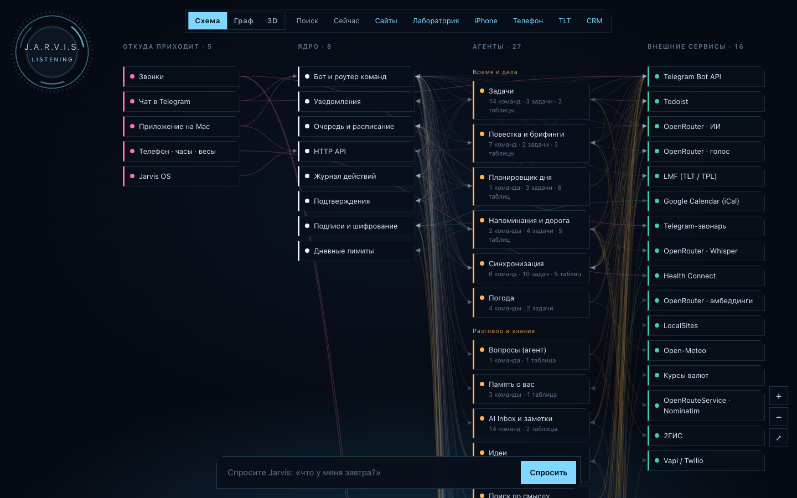
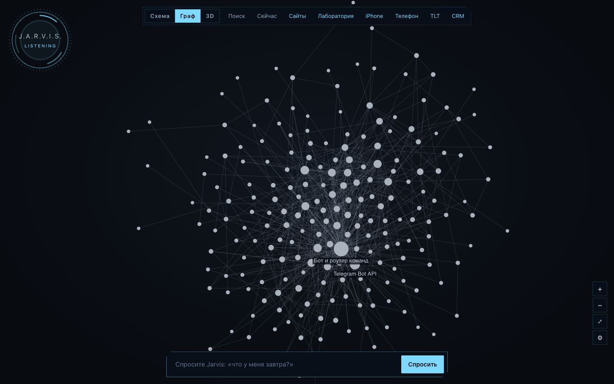
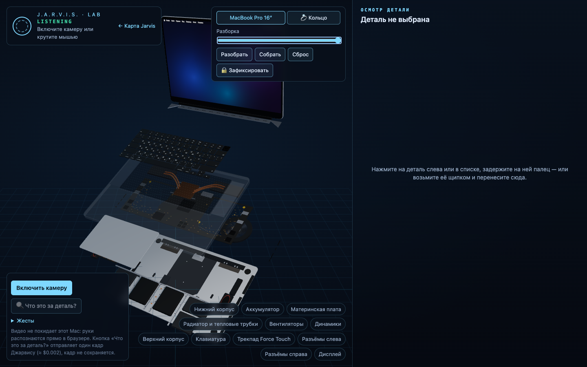
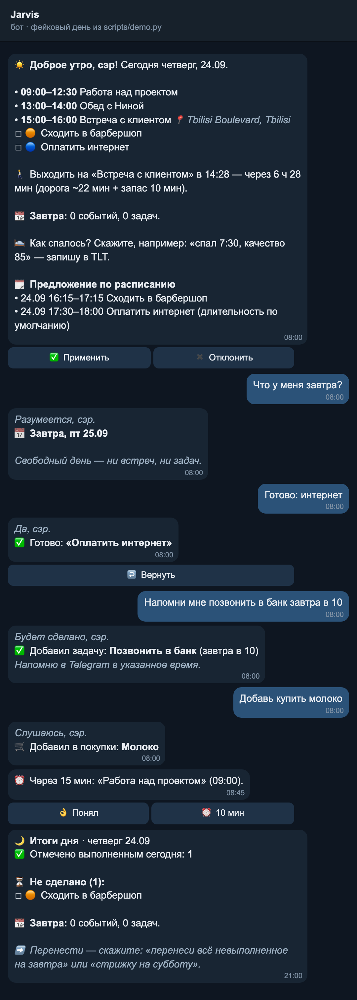
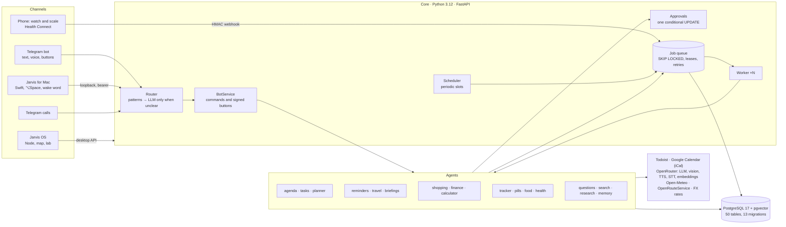

<p align="center"></p>

<h1 align="center">JARVIS OS</h1>

<p align="center">
A personal AI assistant on top of Todoist, Google Calendar and Telegram, with voice, a Mac app and a 3D map of the system.<br>
<a href="README.md">Русский</a> · <b>English</b>
</p>

---

I use it every day; this repository is an anonymised copy. It is a single-user service that brings tasks,
calendar, reminders, shopping, notes, a health tracker and expenses into one chat. You talk to it in text or
voice in Telegram, or on the Mac with a hotkey and the wake word «Джарвис». Code parses everyday phrases; an
LLM steps in only where the meaning of a phrase matters. Anything that changes data in bulk or costs money
waits for a confirmation button.

> The assistant speaks Russian: the phrases below are given in Russian with a translation.

## What it does

| Area | Example phrase | What happens |
|---|---|---|
| Agenda | «что у меня завтра?» (what do I have tomorrow?), `/agenda` | calendar events + Todoist tasks for a day/period, the same item never shown twice |
| Tasks | «перенеси стрижку на 2 часа позже» (move the haircut 2 hours later), «готово: интернет» (done: internet) | complete / move / priority at once; deleting and bulk changes only through an approval button |
| Planner | morning briefing 08:00 | fits untimed tasks into free slots, travel time included; applied after «✅ Применить» |
| Reminders | — | "time to leave" from travel time (OpenRouteService), repeats until «👌 Понял» (got it), voice note and a Telegram call |
| Briefings | 08:00 / 21:00 | the day, weather, travel, a plan; in the evening what is left and where to move it |
| Shopping | «купить молоко» (buy milk), «иду в магазин» (going to the shop) | a shopping list, purchase tasks move into it, «bought» buttons |
| Finance | «потратил 45 лари на такси» (spent 45 lari on a taxi), a receipt photo | recorded at once with «↩️ Отменить» (undo); amounts are `Decimal` minor units; exchange rates |
| Calculator | «10 000 000 ÷ 1500», «15% от 2000» | exact arithmetic on the AST (`Fraction`, no `eval`), never reaches the LLM |
| Health tracker | «спал 7:30, качество 85» (slept 7:30, quality 85), «выпил магний 400 мг» | a draft for the tracker (LMF) → «✅ Записать» (save); numbers dictated in words; food calories from a photo |
| Watch and scale | — | Health Connect → HMAC-signed webhook → sleep, heart rate, steps, weight |
| Search | «найди стрижку» (find the haircut) | lexical + vector (pgvector, bge-m3), merged by reciprocal rank fusion |
| Questions | «сколько встреч на неделе?» (how many meetings this week?) | an agent with one read-only tool `look`, no right to change anything |
| Research | «изучи …» (look into …) | web search through OpenRouter after a button showing the price; the answer comes with sources |
| Mac | «открой Claude Code», «громкость 30» (volume 30) | a closed set of actions; the app re-checks each one and never runs a shell |
| Jarvis OS | menu on the Mac | system map (scheme / graph / 3D), "now", local sites, a 3D lab driven by hand gestures |

## Screenshots (demo data)

| System scheme (built from the code) | Link graph |
|---|---|
|  |  |
| **3D map** | **Lab: taking a model apart with gestures** |
|  |  |

<details>
<summary>A day in Telegram: the simulated day from <code>scripts/demo.py</code> (fake services)</summary>


</details>

## Architecture



**Processes** (Docker Compose): `api` (FastAPI: health, webhooks, admin API, desktop API), `worker` (runs queued
jobs; several can run at once), `scheduler` (turns periodic work into deduplicated jobs), `bot` (Telegram long
polling), `caller` (calls through a second Telegram account), `health` (one signed endpoint open to the home
network), `postgres`.

**Modules** (`jarvis/`):

| Package | Contents |
|---|---|
| `core` | settings (pydantic-settings), clock and time zones, Russian date phrases («в пятницу после обеда», «на 2 часа позже») parsed without an LLM, money, HTTP with retries and a circuit breaker, HMAC/Fernet, budgets, logging with secret redaction |
| `scheduler`, `jobs` | a durable queue in Postgres: `FOR UPDATE SKIP LOCKED`, renewed leases, retries with backoff, dead-letter, `dedupe_key`, time limits |
| `bot` | intent router (patterns → LLM with a strict JSON schema), `BotService`, Telegram HTML, signed buttons |
| `sync` | Todoist cache + webhook, the calendar window, task ↔ event links by title |
| `planner` | a deterministic scheduling engine + proposal → approval → apply |
| `reminders`, `calls`, `voice` | reminder policy, travel time, escalation, at-most-once calls |
| `tracker`, `meds`, `health`, `labs` | daily tracker (LMF), pills and courses, watch/scale, lab results from PDFs |
| `finance`, `calc`, `shopping` | expenses, arithmetic and currencies, the shopping list |
| `search`, `agent`, `profile`, `research`, `ideas` | hybrid search, the question agent, memory about the user, web research, ideas → specs |
| `desktop`, `system`, `sites` | the Mac API, the system map built from code, local sites control |
| `integrations` | adapters: each is a `Protocol` + an HTTP implementation + a `Fake` for tests |

Besides Python, the repository has:

- `desktop/JarvisMac`: a Swift menu-bar app with on-device speech recognition, the wake word and a small HUD window.
- `desktop/system-site`: Jarvis OS, plain Node with no framework. It has a canvas scheme, a graph with its own physics layout, three.js 3D and MediaPipe hand gestures that run in the browser.
- `dev_worker`: a pull-model runner for development jobs. Jobs are signed, repositories come from an allowlist, and nothing is merged automatically.

Decisions and their reasons are in [`DECISIONS.md`](DECISIONS.md). Details are in [`docs/architecture.md`](docs/architecture.md),
[`docs/security.md`](docs/security.md) and [`docs/deployment.md`](docs/deployment.md).

## The rules it is built on

- **The LLM handles meaning only.** Code parses dates, amounts, doses, arithmetic and commands. LLM output
  goes through a strict JSON schema and Pydantic, with one repair attempt. The LLM never supplies database ids:
  references to tasks are resolved in SQL.
- **Side effects are idempotent.** This is what `dedupe_key`, the webhook delivery log, the notification ledger
  and at-most-once calls are for. An approval is one conditional `UPDATE`, so a second press of a button does
  nothing.
- **A human approves** applying a plan, deleting, bulk changes, starting development work and anything paid.
- **Time** is time-zone-aware and stored in UTC: naive `datetime`s are rejected at the ORM type level. **Money**
  is integer minor units and `Decimal`, never float.
- **Security.** Every inline button is HMAC-signed. Forwarded messages never run as commands. Secrets live only
  in `.env` and are redacted from logs. The Mac runs only a closed set of actions.

## Run it in 5 minutes

You need Docker (Compose v2), [uv](https://docs.astral.sh/uv/) and `make`. Jarvis OS also needs Node 20+ and macOS.

**1. No keys at all: tests and a simulated day**

```bash
git clone https://github.com/SelfRenewer/jarvis-os.git && cd jarvis-os
make bootstrap      # Python 3.12 and dependencies via uv, .env from .env.example
make test-db        # Postgres in Docker + the test role (once)
make test           # ruff + mypy + 1062 tests, network blocked, no paid calls
./scripts/demo.sh   # a day on the real code with fake Telegram/Todoist/Calendar → a JSON timeline
```

**2. Jarvis OS on demo data:** the map is built from the code; no Docker needed.

```bash
./scripts/os_demo.sh   # prints http://127.0.0.1:39110/?key=…  (the lab: add &to=/lab)
```

**3. A live Telegram bot**

```bash
uv run jarvis gen-key   # secrets for .env (encryption key, admin API token, …)
```

Fill in `.env`:

- `TELEGRAM_BOT_TOKEN`: from [@BotFather](https://t.me/BotFather).
- `TELEGRAM_ALLOWED_USER_IDS`: your numeric Telegram id.
- `POSTGRES_PASSWORD`: set it before the first start.
- Optional: `OPENROUTER_API_KEY` (free-form phrases, voice), `TODOIST_API_TOKEN`, `GOOGLE_CALENDAR_ICS_URL`
  (the calendar's secret iCal address), `OPENROUTESERVICE_API_KEY` (travel time).

Then:

```bash
make up && make doctor   # the stack + an integration check (no secrets printed, no paid calls)
```

Then send `/start` to the bot. Without `OPENROUTER_API_KEY` every command matched by a pattern still works; the
bot offers to save free-form phrases with buttons.

To install the Mac app, run `./desktop/install.sh`. Then `uv run jarvis desktop-setup` creates its token.

## Tests

| Suite | How it checks |
|---|---|
| unit + integration + e2e (1062) | `make test`: a real Postgres, every external service faked, outbound sockets blocked |
| e2e scenarios | planning a haircut, "time to leave" and a moved event, idea → development, shopping, a duplicate webhook, a restart mid-job |
| Jarvis OS Node checks | `node check.mjs` (81), `graph2d.check.mjs` (14), `device-check.check.mjs` (78), `lan.check.mjs`, `qr.check.mjs`, `lab-*.check.mjs` |
| Intent router | `scripts/eval_router.py`: 112 phrases (paid, about $0.002 a phrase) |
| Live tests | `tests/live`, only with explicit `ALLOW_LIVE_*` flags |
| CI | `.github/workflows/ci.yml`: lint, mypy, migrations up → down → up → drift check, tests, image build |

A bug found in real use gets a regression test (marked `R12`…`R38` in the code).

## How it is built

I build this project with **Claude Code** and **Codex**. My part of the work:

- I set the tasks and decide how the system should behave.
- I choose providers, models and the price/latency trade-offs.
- I set the security rules.
- I check the result on live data and with tests.

Agents write most of the code under my control. No change is accepted without a green `make test` and a live
check. Large changes get full reviews and a security audit, and every bug found gets a regression test.

The repository shows how I run such a project: architecture, invariants, tests, reviews and decisions written
down honestly. It does not claim that every line was typed by hand.

## Roadmap

- [ ] Move from the Mac to a VPS: HTTPS, webhooks instead of polling, Tailscale for the Dev Worker ([`docs/deployment.md`](docs/deployment.md)).
- [ ] A fitness tracker through Google Health → Health Connect instead of the current watch-and-scale setup.
- [ ] Travel time with traffic (Google Routes) as an option next to OpenRouteService.
- [ ] Connect the Dev Worker to a real repository: idea → spec → a branch with changes for review.
- [ ] An English bot interface (phrases and replies are Russian today).
- [ ] Shopping through official store APIs. Scraping Wolt/Bolt is against their terms and is not done.

## License

[MIT](LICENSE) © 2026 SelfRenewer

Third-party code in `desktop/system-site/vendor` (three.js, 3d-force-graph, MediaPipe) keeps its own licenses, listed in [`THIRD_PARTY.md`](desktop/system-site/vendor/THIRD_PARTY.md).
