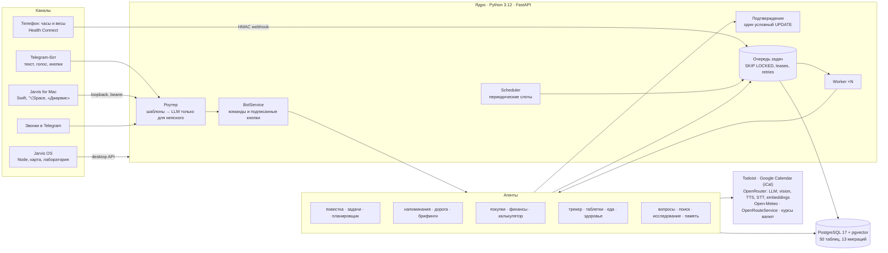

<p align="center"></p>

<h1 align="center">JARVIS OS</h1>

<p align="center">
Личный ИИ-ассистент поверх Todoist, Google Calendar и Telegram, с голосом, приложением для Mac и картой системы в 3D.<br>
<b>Русский</b> · <a href="README.en.md">English</a>
</p>

---

Я пользуюсь им каждый день, а здесь лежит его обезличенная копия. Это сервис для одного человека. Он сводит
задачи, календарь, напоминания, покупки, заметки, трекер здоровья и расходы в один чат. Писать ему можно
текстом, голосом в Telegram или с Mac по горячей клавише и слову «Джарвис». Обычные фразы разбирает код, а
LLM подключается только там, где без смысла фразы не обойтись. Всё, что меняет данные массово или стоит денег,
требует подтверждения кнопкой.

## Что умеет

| Область | Пример фразы | Что происходит |
|---|---|---|
| Повестка | «что у меня завтра?», `/agenda` | события календаря + задачи Todoist на день/период, без дублей одного и того же дела |
| Задачи | «перенеси стрижку на 2 часа позже», «готово: интернет» | выполнить/перенести/приоритет — сразу; удаление и массовые изменения — только через кнопку подтверждения |
| Планировщик | утренний брифинг 08:00 | раскладывает задачи без времени по свободным окнам с учётом дороги; применяется после «✅ Применить» |
| Напоминания | — | «пора выходить» по времени в пути (OpenRouteService), повторы до «👌 Понял», голосом и звонком в Telegram |
| Брифинги | 08:00 / 21:00 | день, погода, дорога, план; вечером — что не сделано и куда перенести |
| Покупки | «купить молоко», «иду в магазин» | список покупок, задачи-покупки переезжают в список, кнопки «куплено» |
| Финансы | «потратил 45 лари на такси», фото чека | запись сразу с «↩️ Отменить», суммы — `Decimal` в минимальных единицах, курсы валют |
| Калькулятор | «10 000 000 ÷ 1500», «15% от 2000» | точная арифметика на AST (`Fraction`, без `eval`), до LLM не доходит |
| Трекер здоровья | «спал 7:30, качество 85», «выпил магний 400 мг» | черновик записи в трекер (LMF) → «✅ Записать»; диктовка числами словами; КБЖУ еды по фото |
| Часы и весы | — | Health Connect → подписанный HMAC webhook → сон, пульс, шаги, вес |
| Поиск | «найди стрижку» | лексический + векторный (pgvector, bge-m3), ранжирование reciprocal rank fusion |
| Вопросы | «сколько встреч на неделе?» | агент с одним read-only инструментом `look`, без права что-либо менять |
| Исследование | «изучи …» | веб-поиск через OpenRouter после кнопки с ценой, ответ с источниками |
| Mac | «открой Claude Code», «громкость 30» | закрытый набор действий, приложение проверяет каждое повторно и не запускает shell |
| Jarvis OS | меню на Mac | карта системы (схема / граф / 3D), «Сейчас», сайты, 3D-лаборатория с жестами рук |

## Скриншоты (на демо-данных)

| Схема системы (строится из кода) | Граф связей |
|---|---|
|  |  |
| **3D-карта** | **Лаборатория: разборка модели жестами** |
|  |  |

<details>
<summary>День в Telegram: смоделированный день из <code>scripts/demo.py</code> (фейковые сервисы)</summary>


</details>

## Архитектура



**Процессы** (Docker Compose): `api` (FastAPI: health, webhooks, admin API, desktop API), `worker` (исполняет
задачи очереди, можно запускать несколько), `scheduler` (раскладывает периодическую работу в задачи с
дедупликацией), `bot` (Telegram long polling), `caller` (звонки через второй аккаунт Telegram), `health`
(в домашнюю сеть смотрит один подписанный endpoint), `postgres`.

**Модули** (`jarvis/`):

| Пакет | Что внутри |
|---|---|
| `core` | настройки (pydantic-settings), часы и часовые пояса, разбор русских дат («в пятницу после обеда», «на 2 часа позже») без LLM, деньги, HTTP с ретраями и circuit breaker, HMAC/Fernet, бюджеты, логирование с редактированием секретов |
| `scheduler`, `jobs` | надёжная очередь в Postgres: `FOR UPDATE SKIP LOCKED`, аренда с продлением, ретраи с backoff, dead-letter, `dedupe_key`, таймауты |
| `bot` | роутер намерений (шаблоны → LLM со строгой JSON-схемой), `BotService`, Telegram HTML, подписанные кнопки |
| `sync` | кэш Todoist + webhook, окно календаря, связи «задача ↔ событие» по названию |
| `planner` | детерминированный движок раскладки + предложение → подтверждение → применение |
| `reminders`, `calls`, `voice` | политика напоминаний, время в пути, эскалация, звонки at-most-once |
| `tracker`, `meds`, `health`, `labs` | трекер дня (LMF), таблетки и курсы, часы/весы, анализы из PDF |
| `finance`, `calc`, `shopping` | расходы, арифметика и валюты, список покупок |
| `search`, `agent`, `profile`, `research`, `ideas` | гибридный поиск, агент вопросов, память о пользователе, веб-исследование, идеи → спецификации |
| `desktop`, `system`, `sites` | API для Mac, карта системы из кода, управление локальными сайтами |
| `integrations` | адаптеры: каждый — `Protocol` + HTTP-реализация + `Fake` для тестов |

Кроме Python в репозитории есть:

- `desktop/JarvisMac`: Swift-приложение в строке меню. Внутри распознавание речи на устройстве, слово «Джарвис» и маленькое окно-HUD.
- `desktop/system-site`: Jarvis OS на Node без фреймворков. Схема на canvas, граф с собственной физикой, 3D на three.js, жесты рук через MediaPipe прямо в браузере.
- `dev_worker`: исполнитель задач разработки по модели pull. Задачи подписаны, репозитории идут по allowlist, ветки не мержатся автоматически.

Решения с обоснованием описаны в [`DECISIONS.md`](DECISIONS.md). Подробности лежат в [`docs/architecture.md`](docs/architecture.md),
[`docs/security.md`](docs/security.md) и [`docs/deployment.md`](docs/deployment.md).

## Принципы, на которых всё держится

- **LLM только для смысла.** Даты, суммы, дозы, арифметика и команды разбираются кодом. Ответ LLM проходит
  через строгую JSON-схему и Pydantic, на ошибку даётся одна попытка исправления. Идентификаторы из базы LLM
  не выдаёт никогда: ссылки на задачи разрешаются в SQL.
- **Побочные эффекты идемпотентны.** На это работают `dedupe_key`, журнал доставленных webhook, журнал
  уведомлений и звонки at-most-once. Подтверждение выполняется одним условным `UPDATE`, так что повторное
  нажатие кнопки ничего не делает.
- **Человек подтверждает** применение плана, удаление, массовые изменения, запуск разработки и всё платное.
- **Время** хранится в UTC с часовым поясом: наивные `datetime` отвергаются на уровне типа ORM. **Деньги**
  считаются целыми минимальными единицами и `Decimal`, без float.
- **Безопасность.** Каждая inline-кнопка подписана HMAC. Пересланные сообщения не исполняются как команды.
  Секреты хранятся только в `.env` и вычищаются из логов. Mac выполняет только закрытый набор действий.

## Запуск за 5 минут

Нужны Docker (Compose v2), [uv](https://docs.astral.sh/uv/), `make`. Для Jarvis OS ещё Node 20+ и macOS.

**1. Без единого ключа: тесты и смоделированный день**

```bash
git clone https://github.com/SelfRenewer/jarvis-os.git && cd jarvis-os
make bootstrap      # Python 3.12 и зависимости через uv, .env из .env.example
make test-db        # Postgres в Docker + тестовая роль (один раз)
make test           # ruff + mypy + 1062 теста, сеть закрыта, платных вызовов нет
./scripts/demo.sh   # день на настоящем коде с фейковыми Telegram/Todoist/Calendar → JSON-таймлайн
```

**2. Jarvis OS на демо-данных:** карта строится из кода, Docker не нужен.

```bash
./scripts/os_demo.sh   # печатает ссылку http://127.0.0.1:39110/?key=…  (лаборатория: добавьте &to=/lab)
```

**3. Живой бот в Telegram**

```bash
uv run jarvis gen-key   # секреты для .env (ключ шифрования, токен admin API, …)
```

Заполните `.env`:

- `TELEGRAM_BOT_TOKEN`: токен от [@BotFather](https://t.me/BotFather).
- `TELEGRAM_ALLOWED_USER_IDS`: ваш числовой Telegram ID.
- `POSTGRES_PASSWORD`: задайте до первого запуска.
- По желанию: `OPENROUTER_API_KEY` (понимание свободных фраз, голос), `TODOIST_API_TOKEN`,
  `GOOGLE_CALENDAR_ICS_URL` (секретный iCal-адрес календаря), `OPENROUTESERVICE_API_KEY` (время в пути).

Затем:

```bash
make up && make doctor   # стек + проверка интеграций (секреты не печатаются, платных вызовов нет)
```

После этого напишите боту `/start`. Без `OPENROUTER_API_KEY` работают все команды, которые разбираются
шаблонами. Свободные фразы бот предложит сохранить кнопками.

Приложение для Mac ставится командой `./desktop/install.sh`. Затем `uv run jarvis desktop-setup` создаёт для
него токен.

## Тесты

| Набор | Чем проверяется |
|---|---|
| unit + integration + e2e (1062) | `make test`: настоящий Postgres, все внешние сервисы заменены фейками, сокеты наружу заблокированы |
| e2e-сценарии | планирование стрижки, «пора выходить» и перенос события, идея → разработка, покупки, дубль webhook, рестарт посреди задачи |
| Node-проверки Jarvis OS | `node check.mjs` (81), `graph2d.check.mjs` (14), `device-check.check.mjs` (78), `lan.check.mjs`, `qr.check.mjs`, `lab-*.check.mjs` |
| Роутер намерений | `scripts/eval_router.py`: 112 фраз (платно, ~$0.002 за фразу) |
| Live-тесты | `tests/live`, только с явными `ALLOW_LIVE_*` |
| CI | `.github/workflows/ci.yml`: lint, mypy, миграции up → down → up → drift, тесты, сборка образа |

Найденный вживую баг закрывается регрессионным тестом (в коде помечены как `R12`…`R38`).

## Как это сделано

Проект я собираю вместе с **Claude Code** и **Codex**. Моя часть работы:

- ставлю задачи и решаю, как система должна себя вести;
- выбираю провайдеров, модели и компромиссы по цене и задержке;
- задаю правила безопасности;
- проверяю результат на живых данных и тестами.

Код по большей части пишут агенты под моим контролем. Ни одно изменение не принимается без зелёного
`make test` и проверки вживую. Для крупных изменений проводятся отдельные полные ревью и аудит
безопасности, а каждый найденный баг закрывается регрессионным тестом.

Этот репозиторий показывает, как я веду такой проект: архитектура, инварианты, тесты, ревью и честная фиксация
решений. Он не претендует на то, что каждая строка набрана вручную.

## Дорожная карта

- [ ] Переезд с Mac на VPS: HTTPS, webhooks вместо polling, Tailscale для Dev Worker ([`docs/deployment.md`](docs/deployment.md)).
- [ ] Фитнес-трекер через Google Health → Health Connect на месте нынешней связки часов и весов.
- [ ] Время в пути с пробками (Google Routes) как опция рядом с OpenRouteService.
- [ ] Подключить Dev Worker к реальному репозиторию: идея → спецификация → ветка с изменениями на ревью.
- [ ] Английский интерфейс бота (сейчас фразы и ответы на русском).
- [ ] Покупки через официальные API магазинов. Скрейпинг Wolt/Bolt запрещён их правилами и не делается.

## Лицензия

[MIT](LICENSE) © 2026 SelfRenewer

Сторонний код в `desktop/system-site/vendor` (three.js, 3d-force-graph, MediaPipe) лежит под своими лицензиями, список в [`THIRD_PARTY.md`](desktop/system-site/vendor/THIRD_PARTY.md).
